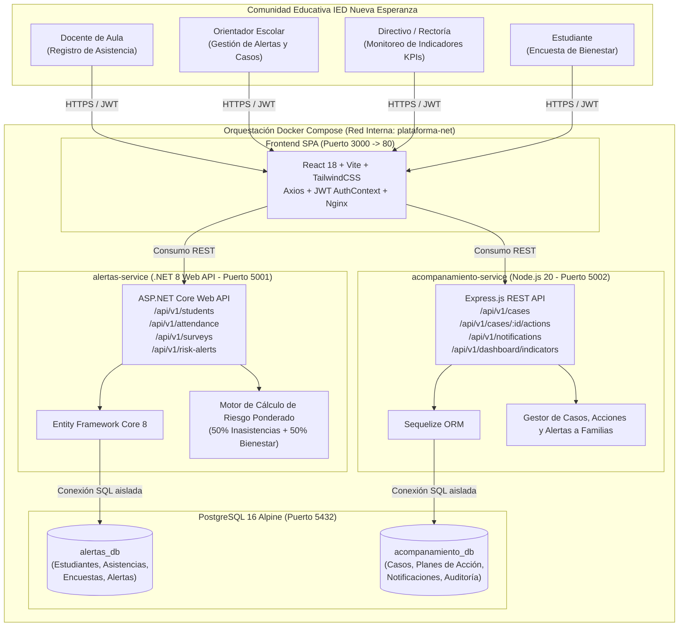

# Plataforma de Alerta Temprana y Acompañamiento Escolar
### Institución Educativa Distrital Nueva Esperanza — Municipio de Soacha
**Solución Digital Basada en Microservicios Docker para Mitigar la Deserción Escolar en Grados 8.º a 11.º**

---

## 1. Contexto del Problema y Justificación
La **IED Nueva Esperanza**, ubicada en el municipio de Soacha, enfrenta una problemática crítica de inasistencia reiterada y deserción escolar en los grados 8.º, 9.º, 10.º y 11.º. Con base en el diagnóstico del **Árbol de Problemas** (población encuestada: 60 estudiantes, 10 docentes, 20 acudientes), se identificaron las siguientes causas estructurales:

- **Limitaciones económicas familiares (37%):** Dificultades para adquirir materiales escolares, alimentación o conectividad.
- **Responsabilidades de trabajo o cuidado (28%):** Jóvenes que asumen labores informales o cuidado de familiares dependientes.
- **Dificultades de transporte y distancia (25%):** Traslados extensos desde comunas periféricas (Altos de Cazucá, Compartir), alto costo del pasaje o inseguridad en trayectos.
- **Acompañamiento insuficiente para nivelación (31%):** Desesperanza y rezago frente a materias reprobadas sin tutoría oportuna.
- **Desmotivación y bajo sentido de pertenencia (35%):** Desconexión curricular y experiencias de conflicto o acoso escolar.

### Propósito de la Solución
Transformar señales tempranas de riesgo (inasistencias acumuladas y factores socioeconómicos) en **acciones de acompañamiento pedagógico y psicosocial oportunas**, evitando que las ausencias iniciales se conviertan en abandono definitivo. 

> **Principio Ético Fundamental:** Las alertas emitidas son exclusivamente señales para la intervención y el diálogo humano multidisciplinario. El sistema **no califica negativamente, no etiqueta permanentemente al menor ni toma decisiones automáticas de exclusión**.

---

## 2. Arquitectura de la Solución (Microservicios Docker)



---

## 3. Requisitos Previos
- **Docker Engine** (versión 24.0 o superior)
- **Docker Compose** (versión v2.20 o superior)
- Navegador web moderno (Chrome, Firefox, Edge, Safari)
- Puertos libres en el host: `3000` (Frontend), `5001` (Alertas API), `5002` (Acompañamiento API), `5432` (PostgreSQL).

---

## 4. Instrucciones de Despliegue con Docker Compose
Todo el entorno se compila, migra y siembra automáticamente en un solo paso:

```bash
# 1. Clonar el repositorio y ubicarse en la raíz del proyecto
cd plataforma-alerta-temprana

# 2. (Opcional) Copiar variables de entorno si desea modificarlas
cp .env.example .env

# 3. Compilar imágenes y levantar todos los contenedores
docker compose up --build
```

Una vez finalizada la compilación, los servicios estarán disponibles en:
- **Frontend Web Institucional:** [http://localhost:3000](http://localhost:3000)
- **Microservicio Alertas (Swagger UI):** [http://localhost:5001/swagger](http://localhost:5001/swagger)
- **Microservicio Acompañamiento (Healthcheck):** [http://localhost:5002/health](http://localhost:5002/health)
- **Base de Datos PostgreSQL:** `localhost:5432` (Usuario: `postgres`, Password: `postgres_secure_pass_2026`)

---

## 5. Credenciales de Prueba Preconfiguradas (Seed Data)
El sistema arranca con 60 estudiantes (grados 8.º a 11.º), 10 docentes y 20 acudientes precargados. Puede ingresar usando los botones de **Acceso Rápido** en la pantalla de login o con estas credenciales:

| Rol | Correo Electrónico | Contraseña | Capacidades Principales |
|---|---|---|---|
| **Orientador** | `orientador@nuevaesperanza.edu.co` | `Orientador123*` | Supervisión de alertas, apertura de casos, planes de intervención, avisos a acudientes. |
| **Docente** | `docente1@nuevaesperanza.edu.co` | `Docente123*` | Toma de asistencia diaria por curso (8-A a 11-B), justificaciones. |
| **Directivo** | `directivo@nuevaesperanza.edu.co` | `Directivo123*` | Tablero de indicadores agregados (KPIs), retención escolar por grados. |
| **Estudiante** | `estudiante@nuevaesperanza.edu.co` | `Estudiante123*` | Diligenciamiento de la encuesta de bienestar escolar. |
| **Administrador** | `admin@nuevaesperanza.edu.co` | `Admin123*` | Recálculo masivo de riesgo, registro de estudiantes y docentes, auditoría total. |

---

## 6. Catálogo de Endpoints REST (/api/v1)

### 6.1. Microservicio 1: Alertas y Riesgo (`alertas-service` - C# .NET 8)
| Método | Endpoint | Rol Mínimo | Descripción |
|---|---|---|---|
| `POST` | `/api/v1/auth/login` | Público | Autenticación y generación de token JWT. |
| `POST` | `/api/v1/students` | Administrador / Orientador | Creación de perfil de estudiante con acudiente y comuna. |
| `GET` | `/api/v1/students` | Autenticado | Listado de estudiantes con filtro por grado (`?grade=8-A`). |
| `GET` | `/api/v1/students/{studentId}` | Autenticado | Perfil detallado, métricas de inasistencia y salvedad ética. |
| `POST` | `/api/v1/attendance` | Docente / Administrador | Registro de asistencia (Presente, Ausente, Tarde, Justificada). Dispara recálculo automático. |
| `GET` | `/api/v1/attendance/{studentId}`| Autenticado | Historial completo de asistencia del estudiante. |
| `POST` | `/api/v1/surveys/responses` | Estudiante / Orientador | Guarda encuesta de bienestar y recalcula riesgo integral. |
| `GET` | `/api/v1/risk-alerts` | Orientador / Directivo / Docente | Consulta alertas filtradas por nivel (`high`/`medium`) y grado. |
| `POST` | `/api/v1/risk-alerts/recalculate`| Administrador / Orientador | Recálculo masivo de reglas de riesgo para toda la institución. |
| `PATCH`| `/api/v1/risk-alerts/{id}/acknowledge`| Orientador | Marca alerta como revisada en orientación. |

### 6.2. Microservicio 2: Acompañamiento (`acompanamiento-service` - Node.js Express)
| Método | Endpoint | Rol Mínimo | Descripción |
|---|---|---|---|
| `POST` | `/api/v1/auth/login` | Público | Autenticación institucional en módulo de acompañamiento. |
| `POST` | `/api/v1/cases` | Orientador / Administrador | Abre caso de acompañamiento escolar vinculado a alerta. |
| `GET` | `/api/v1/cases` | Orientador / Directivo / Docente | Lista casos con filtros de estado y prioridad. |
| `GET` | `/api/v1/cases/{caseId}` | Orientador / Directivo / Admin | Consulta detalle del caso, historial de acciones y contactos. |
| `PATCH`| `/api/v1/cases/{caseId}` | Orientador / Administrador | Actualiza estado (Abierto, EnSeguimiento, Cerrado) y notas. |
| `POST` | `/api/v1/cases/{caseId}/actions` | Orientador / Administrador | Crea una acción del plan de intervención con responsable y fecha. |
| `PATCH`| `/api/v1/cases/{caseId}/actions/{id}`| Responsable Asignado | Actualiza estado de acción y registra evidencia de seguimiento. |
| `POST` | `/api/v1/notifications` | Orientador / Directivo | Registra aviso al acudiente por canal autorizado (WhatsApp/SMS). |
| `GET` | `/api/v1/notifications` | Orientador / Directivo / Admin | Bitácora de auditoría de comunicaciones enviadas a familias. |
| `GET` | `/api/v1/dashboard/indicators` | Directivo / Orientador / Admin | Indicadores agregados de permanencia, casos y tiempo promedio. |

---

## 7. Estrategia Git y GitHub

### 7.1. Modelo de Ramas (GitFlow Simplificado)
- `main`: Rama de producción estable. Protegida contra pushes directos. Despliegues automatizados.
- `develop`: Rama de integración activa para features completadas.
- `feature/<nombre>`: Ramas de funcionalidad (ej. `feature/modulo-notificaciones-sms`). Nacen de `develop` y se integran mediante Pull Request con revisión de pares.
- `fix/<nombre>`: Corrección puntual de defectos.

### 7.2. Convención de Mensajes de Commit (Conventional Commits)
- `feat: agregar exportación anonimizada de retención escolar`
- `fix: corregir cálculo de umbral de riesgo en ausencias justificadas`
- `docs: actualizar documentación de endpoints en api-specs.md`
- `test: incorporar pruebas unitarias de recálculo en xUnit`
- `chore: optimizar capas de compilación en Dockerfile multi-stage`

### 7.3. Integración Continua (GitHub Actions)
El repositorio incluye el pipeline `.github/workflows/ci.yml` que valida automáticamente ante cada push o PR:
1. Compilación de .NET 8 y ejecución de pruebas unitarias xUnit de `alertas-service`.
2. Instalación limpia y ejecución de pruebas Jest de `acompanamiento-service`.
3. Verificación de compilación del bundle de producción de Vite en `frontend`.
4. Validación sintáctica del descriptor `docker-compose.yml`.

---

## 8. Checklist de Verificación End-to-End (Flujo Completo)

Puede validar el funcionamiento integrado del sistema siguiendo estos 6 pasos secuenciales:

1. **Paso 1: Inicio de Sesión como Docente**
   - Ingrese a [http://localhost:3000/login](http://localhost:3000/login) y haga clic en el botón rápido **Docente**.
   - Vaya a **Toma de Asistencia** en la barra lateral.
2. **Paso 2: Registro de Ausencias en el Aula**
   - Seleccione el curso `8-A`. Marque a dos estudiantes en estado **Ausente (A)** y agregue un motivo (ej. *"Inasistencia por dificultades de transporte"*).
   - Haga clic en **Guardar Asistencia**. El microservicio en C# guardará los registros y disparará automáticamente el motor de recálculo de riesgo.
3. **Paso 3: Consulta y Priorización de Alertas (Orientador)**
   - Cierre sesión y entre con el botón rápido **Orientador**.
   - Navegue a **Alertas de Riesgo**. Verifique que los estudiantes con ausencias acumuladas aparecen clasificados con badge de **Alerta Media** o **Alerta Alta**.
4. **Paso 4: Apertura del Caso de Acompañamiento**
   - En la fila del estudiante en riesgo alto, haga clic en **Abrir Caso**.
   - Ingrese la justificación (ej. *"Se detecta patrón de ausencias los viernes por apoyo laboral familiar en Cazucá"*) y defina la prioridad en **Alta**.
   - Haga clic en **Crear y Derivar a Acompañamiento**. El sistema registrará el caso en el microservicio Node.js.
5. **Paso 5: Plan de Intervención y Notificación a la Familia**
   - En **Casos y Planes**, seleccione el caso abierto.
   - Haga clic en **Contactar Acudiente** para registrar un mensaje preventivo por WhatsApp/SMS.
   - Haga clic en **Nueva Acción** y agregue *"Entrevista con acudiente y articulación con subsidio de transporte"*.
   - Posteriormente, haga clic en **Registrar Avance** en una acción y guarde la evidencia del compromiso familiar alcanzado.
6. **Paso 6: Monitoreo en el Panel Institucional (Directivo)**
   - Navegue al **Panel Institucional**.
   - Confirme la actualización inmediata de los KPIs: incremento en casos atendidos, porcentaje de planes completados y métrica de tiempo promedio alerta-contacto (horas).
