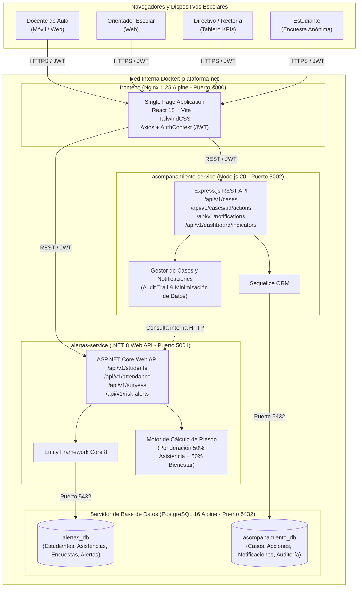

# Arquitectura de Software - Plataforma de Alerta Temprana y Acompañamiento Escolar
**Institución Educativa Distrital Nueva Esperanza (Soacha)**

---

## 1. Visión General de la Solución
La deserción escolar en educación secundaria (grados 8.º a 11.º) en Soacha responde a una problemática multicausal identificada en el Árbol de Problemas:
- **Limitaciones económicas familiares** (37%)
- **Necesidad de trabajar o cuidar a familiares** (28%)
- **Dificultades y costo de transporte en comunas como Cazucá y Compartir** (25%)
- **Falta de apoyo pedagógico para nivelar aprendizajes** (31%)
- **Desmotivación y bajo sentido de pertenencia** (35%)

La solución digital separa deliberadamente la **detección temprana del riesgo** (cálculo cuantitativo y agregaciones de inasistencia) de la **gestión formativa del caso** (acciones psicosociales, bitácora cualitativa y contacto con familias) a través de dos microservicios autónomos empaquetados en contenedores Docker.

---

## 2. Diagrama de Arquitectura de Contenedores (C4 Container Diagram en Mermaid)

---

## 3. Justificación de Decisiones Tecnológicas

### 3.1. ¿Por qué C# (.NET 8) para `alertas-service`?
1. **Rendimiento numérico y concurrencia**: La toma de asistencia institucional genera ráfagas de escrituras concurrentes (docentes pasando lista en paralelo en cada cambio de bloque horario). .NET 8 ofrece un rendimiento superior en Kestrel y optimización en compilación JIT.
2. **Tipado fuerte para cálculos deterministas**: El cálculo de riesgo pondera tasas de ausencia, factores booleanos de encuestas y umbrales matemáticos. El sistema de tipos estático y LINQ garantizan exactitud numérica e invariantes de dominio.
3. **Robustez transaccional con Entity Framework Core**: Manejo fiable de restricciones únicas compuestas (un estudiante solo puede tener un registro por fecha) y migraciones estructuradas.

### 3.2. ¿Por qué JavaScript (Node.js + Express) para `acompanamiento-service`?
1. **Flexibilidad en flujos y documentos de intervención**: Los planes de acción, las bitácoras cualitativas de orientación y los seguimientos con familias son cualitativos y evolutivos. Node.js maneja con alta soltura transformaciones JSON dinámicas.
2. **Integración con canales de notificación**: Facilidad nativa para interactuar asíncronamente con proveedores de mensajería (WhatsApp Cloud API, SMS Twilio, SMTP).
3. **Ecosistema ágil para reportes analíticos agregados**: La agregación de métricas de permanencia y tiempos de contacto se beneficia del modelo orientado a eventos no bloqueante de Node.js.

### 3.3. Decisión de Base de Datos: Servidor Único PostgreSQL 16 con Dos Bases de Datos Lógicas Independientes
- **Decisión adoptada**: Una sola instancia física de PostgreSQL 16 Alpine en Docker Compose, conteniendo dos bases de datos lógicas aisladas: `alertas_db` y `acompanamiento_db`.
- **Justificación**:
  - **Patrón Database-per-Service**: Cada microservicio tiene credenciales independientes y esquemas estrictamente aislados. Ningún microservicio puede hacer JOINs directos a las tablas del otro, respetando los *Bounded Contexts* de Domain-Driven Design (DDD).
  - **Optimización de recursos en desarrollo local**: Ejecutar dos motores de bases de datos independientes en Docker duplicaría el consumo de memoria RAM (de ~40MB a ~80-120MB en reposo) y ralentizaría el arranque local.
  - **Preparado para producción**: En un despliegue cloud (AWS RDS o Azure Database), cada base de datos puede moverse a una instancia administrada separada simplemente cambiando la variable de entorno de conexión (`ALERTAS_CONNECTION_STRING` y `ACOMPANAMIENTO_DB_URI`), sin alterar una sola línea de código fuente.

---

## 4. Marco de Seguridad, Privacidad y Ética (Menores de Edad)
1. **No Etiquetado Permanente ni Exclusión Automática**:
   El sistema implementa en base de datos y en todas las vistas de usuario una salvedad ética explícita:
   > *"Las alertas son señales tempranas para orientar la intervención pedagógica y psicosocial humana. No constituyen una decisión automática ni etiquetado definitivo del estudiante."*
2. **Protección de Datos Sensibles (Ley 1581 de 2012 de Colombia)**:
   - Los reportes del dashboard institucional son agregados estadísticos sin identificación de nombres o documentos de menores.
   - Las encuestas de bienestar registran consentimiento informado y anonimización en agregados.
   - Los tokens JWT tienen expiración corta (60 minutos) con validación criptográfica simétrica HMAC SHA-256.
   - Control de Acceso Basado en Roles (RBAC) estricto en cada endpoint HTTP.
